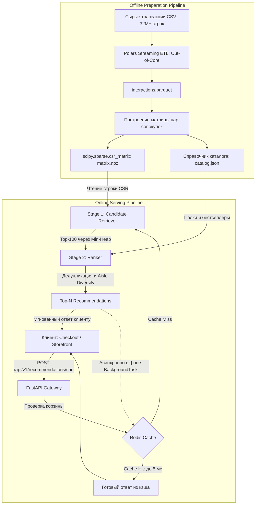

# High-Level Design (HLD): Two-Stage Retail Recommender System

## 1. System Context & Business Objectives

Сервис предназначен для решения задачи дополнения продуктовой корзины в реальном времени (Basket Completion / Next-Item Suggestion) на транзакционных данных ритейла (Instacart Market Basket Analysis).

Потребители сервиса:
- **Checkout Service (Экран оформления заказа):** запрашивает рекомендации сопутствующих товаров перед переходом к оплате;
- **Mobile / Web BFF (Backend-For-Frontend):** запрашивает блок рекомендаций «С этими товарами покупают» при обновлении корзины покупателем.

Ключевой сценарий работы: прием набора идентификаторов товаров корзины (`cart_items`) и возврат ранжированного списка Top-$N$ дополнительных позиций с гарантией фильтрации дубликатов и диверсификации выдачи.

---

## 2. Non-Functional Requirements & Performance SLAs

Система проектируется с учетом жестких ограничений по времени отклика в синхронном цикле оформления покупки:

| Метрика | Целевое значение (SLA) | Обоснование / Примечание |
| :--- | :--- | :--- |
| **Latency (Cache Hit)** | $p95 < 5$ мс | Возврат готового ответа из оперативной памяти Redis. |
| **Latency (Cache Miss / Full Inference)** | $p95 < 25$ мс | Полный цикл двухстадийного инференса (Retrieval + Ranking). |
| **Throughput** | До 200 RPS на инстанс | Обслуживание одним контейнером FastAPI / Uvicorn. |
| **RAM Footprint (Serving)** | $\le 500$ МБ | Хранение сжатой CSR-матрицы сопокупок и каталога в памяти процесса. |
| **Graceful Degradation** | 100% доступность (200 OK) | При недоступности Redis или сбое скоринга — возврат глобального fallback. |

---

## 3. High-Level Architecture & Data Pipelines

Архитектура системы строго разделена на оффлайн-контур подготовки артефактов и онлайн-контур высокопроизводительного инференса. Реляционные СУБД в Serving-контуре исключены: инференс выполняется строго In-Memory.



### 3.1. Этапы движения данных:
1. **Offline Pipeline (Подготовка данных):**
   - Потоковое чтение 32 млн транзакций через `Polars LazyFrame` чанками без загрузки всего CSV в RAM;
   - Формирование симметричной разреженной матрицы сопокупок `scipy.sparse.csr_matrix` с весами `float32`;
   - Сериализация артефактов на диск: сжатая матрица `matrix.npz`, маппинги `item_to_idx.json`, каталог метаданных `catalog.json`;
   - Формирование микросреза `data/sample/` (до 1 000 строк) для воспроизводимости юнит-тестов и CI без тяжелых файлов.
2. **Online Serving Pipeline (Инференс):**
   - **In-Memory Startup:** при инициализации приложения (`lifespan startup`) FastAPI единовременно загружает `matrix.npz` и `catalog.json` в оперативную память процесса. Все математические операции производятся в RAM без дискового I/O;
   - Запрос проходит проверку в кэше Redis по детерминированному ключу (SHA-256 отсортированного списка `cart_items`);
   - При Cache Miss:
     - **Stage 1 (Retrieval):** сложение срезов строк CSR-матрицы для товаров корзины и отбор пула Top-100 кандидатов через Binary Min-Heap за $O(M \log N)$;
     - **Stage 2 (Ranking):** исключение товаров корзины, вторичный скоринг с учетом вероятности повторного заказа (`reordered`) и диверсификация по товарным рядам (Aisle Diversity — не более 2 товаров одной категории);
   - Асинхронное кэширование ответа в Redis (TTL = 3600 с) и возврат результата клиенту.

---

## 4. Data Contracts & API Specification

Сервис реализует REST-контракт взаимодействия по протоколу HTTP/JSON.

### 4.1. Запрос рекомендаций к корзине
- **Метод:** `POST`
- **Путь:** `/api/v1/recommendations/cart`

**Пример тела запроса (Request Body):**
```json
{
  "cart_items": [13176, 47209, 21903],
  "target_n": 3
}
```

### 4.2. Ответ сервиса
- **Код ответа:** `200 OK`

**Пример тела ответа (Response Body):**
```json
{
  "items": [
    {
      "item_id": 21137,
      "title": "Organic Strawberries",
      "score": 0.8421,
      "aisle_id": 24
    },
    {
      "item_id": 24852,
      "title": "Banana",
      "score": 0.7915,
      "aisle_id": 24
    },
    {
      "item_id": 47766,
      "title": "Organic Avocado",
      "score": 0.6540,
      "aisle_id": 83
    }
  ],
  "latency_ms": 3.82,
  "cache_hit": false,
  "fallback_applied": false
}
```

### 4.3. Обработка краевых сценариев и отказоустойчивость:
- **Пустая корзина или неизвестные ID (Cold Start):** сервис возвращает Top-$N$ глобальных бестселлеров из каталога со статусом `200 OK` и флагом `"fallback_applied": true`.
- **Невалидная схема данных (пустой payload, отрицательные ID, $N \le 0$):** `422 Unprocessable Entity` (валидация Pydantic v2).
- **Сбой инфраструктуры кэша (Redis Timeout / Disconnect):** прозрачное переключение на прямой матричный инференс без возврата ошибки 500 (Graceful Degradation).

---

## 5. Architectural Decision Records (ADR)

### ADR-01: Использование разреженной CSR-матрицы взамен Dense NumPy Array
- **Контекст:** В каталоге насчитывается $\approx 50\,000$ уникальных товаров. Плотная матрица сопокупок размером $50\,000 \times 50\,000$ типа `float32` требует в оперативной памяти:
  $$50\,000 \times 50\,000 \times 4 \text{ байта} \approx 10 \text{ ГБ RAM}$$
- **Решение:** Применение формата `scipy.sparse.csr_matrix`. Так как матрица сопокупок разрежена более чем на 99.8%, хранятся только ненулевые пары через массивы `data`, `indices` и `indptr`.
- **Результат:** Объём используемой памяти сокращён до $\approx 120$–$180$ МБ RAM, устранена угроза Out-Of-Memory (OOM).

### ADR-02: Использование Binary Min-Heap для Top-$N$ селектора
- **Контекст:** На этапе Retrieval формируется вектор оценок сходства по всему каталогу ($M \approx 50\,000$ позиций), из которого требуется отобрать Top-$N$ (по умолчанию $N = 100$) лучших кандидатов.
- **Решение:** Применение двоичной Min-Heap фиксированного размера $N$.
- **Сложность:**
  - Наивная полная сортировка: $O(M \log M)$ по времени, $O(M)$ по дополнительной памяти;
  - Min-Heap селектор: $O(M \log N)$ по времени, $O(N)$ по дополнительной памяти.
- **Результат:** Ускорение отбора кандидатов более чем в 4 раза, детерминированный расход памяти при высоких нагрузках.

### ADR-03: Потоковая Out-of-Core обработка данных через Polars
- **Контекст:** Датасет транзакций Instacart превышает 32 млн записей (более 1.5 ГБ в CSV). Обработка через Pandas требует единовременной загрузки таблицы в память с 3–5 кратным оверхедом по RAM.
- **Решение:** Использование `Polars LazyFrame` (`scan_csv`) и потоковой агрегации транзакций чанками с сохранением промежуточного результата в сжатый `Parquet`.
- **Результат:** Пиковое потребление памяти на этапе ETL ограничено лимитом в 2–3 ГБ, время выполнения снижено благодаря многопоточному движку на Rust.

### ADR-04: Кэширование по паттерну Cache-Aside на базе Redis
- **Контекст:** Повторяющиеся типовые составы корзин создают избыточную нагрузку на матричный вычислительный слой.
- **Решение:** Внедрение слоя Redis с TTL = 3600 с. Ключ кэша формируется детерминированно как SHA-256 хэш отсортированного списка `cart_items`.
- **Результат:** Снижение задержки ответа для частых запросов с 20 мс до $<3$ мс, разгрузка CPU для редких корзин.